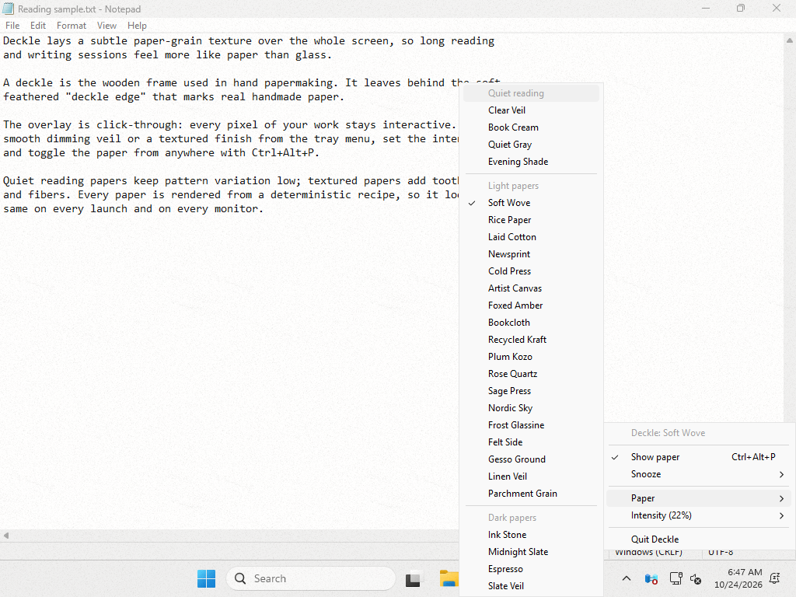
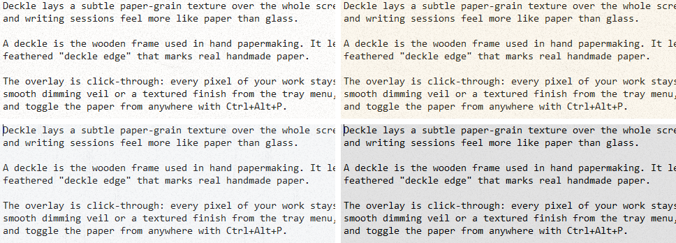

# Deckle for Windows (preview)

A native Windows port of Deckle's core: the same deterministic paper texture over every display, controlled from the notification area. It is a small Rust program with one dependency, Microsoft's [`windows-sys`](https://crates.io/crates/windows-sys) bindings, and needs no runtime.





<sub>Captured by the CI smoke test on a GitHub-hosted Windows runner. The grid shows Soft Wove, Foxed Amber, Linen Veil, and Ink Stone, left to right and top to bottom.</sub>

## What it does

- **Paper on every monitor.** Each monitor gets one borderless, click-through, always-on-top layered window that never takes focus or appears in Alt+Tab. Each window renders at its monitor's own display scale.
- **All 26 built-in papers**, rendered by a port of the macOS v4 spectral fiber engine. Paper ids, seeds, and recipes match the Mac app.
- **Tray menu.** Click or right-click the paper icon in the notification area to:
  - show or hide the paper
  - snooze for 15 minutes, 30 minutes, 1 hour, or 2 hours, or resume
  - pick a paper (quiet reading, light, or dark)
  - set the intensity (5–45%; the default is 22%)
- **Ctrl+Alt+P** toggles the paper from any app. If another program already owns the shortcut, the menu says it is unavailable.
- **Settings persist** in `%APPDATA%\Deckle\settings.ini`. A snooze is never saved, so quitting ends it, as on macOS.
- **Idle is idle.** Nothing polls or animates. Deckle wakes only for menu clicks, the hotkey, a snooze ending, display changes, and other windows activating, so it can keep the paper on top.

Not yet ported: Paper Mill and custom papers, importing `.decklepaper.json` files, desk setups, pets, per-app rules, grain and matte controls, capture privacy, `deckle://` automation, launch at login, and self-update.

## Build and run

Requires Windows 10 or later and a Rust toolchain ([rustup](https://rustup.rs)).

```powershell
cd windows
cargo run --release            # build and launch
cargo test                     # unit tests (renderer, papers, settings, state, menu)
```

The executable is `windows\target\release\deckle.exe`. CI builds it for every pull request; download it from the run's `deckle-windows` artifact. The build is unsigned, so SmartScreen may warn on first launch.

CI also runs `scripts/smoke.ps1` on the Windows runner. The script launches `deckle.exe` over a page of text in Notepad and fails unless the tray window and a visible overlay appear and the overlay changes the screen. It also saves screenshots of four papers and the tray menu, which CI uploads as the `deckle-windows-screenshots` artifact. To run it locally after a release build:

```powershell
pwsh -File scripts\smoke.ps1 -Exe target\release\deckle.exe -OutDir screenshots
```

The renderer, paper library, settings, state, menu model, and tray icon are plain Rust, so `cargo test` also runs on macOS and Linux. Only `src/win/` needs Windows. To type-check it elsewhere:

```sh
rustup target add x86_64-pc-windows-msvc
cargo clippy --all-targets --target x86_64-pc-windows-msvc -- -D warnings
```

## How it works

| File | Responsibility |
|---|---|
| `src/papers.rs` | The 26 built-in papers, value-for-value from `TexturePreset.swift` |
| `src/renderer.rs`, `src/fft.rs`, `src/rng.rs` | v4 spectral fiber renderer, radix-2 inverse FFT, SplitMix64 |
| `src/state.rs`, `src/settings.rs` | Enabled, snooze, intensity, and paper rules; tolerant settings file |
| `src/menu.rs`, `src/glyph.rs` | Tray menu as testable data; the tray icon drawn in code |
| `src/win/` | Overlay windows, tray icon and menu, hotkey, timers |

- **Rendering.** The renderer builds one seamless tile of 256 points: 256 pixels at up to 150% display scale, 512 above. It synthesizes a random-phase, Hermitian-symmetric spectrum, inverse-transforms it into a real field, and layers weave, fiber splats, flecks, tapered fiber strands, and darkening surface roughness. Pixels are not byte-identical to macOS, because the platforms' FFTs and math libraries round differently in the last bits. Every structural choice and random draw follows the Swift code, though, so each paper's grain looks the same.
- **Painting.** When the paper, scale, or monitor size changes, the tile is repeated into a monitor-sized bitmap and handed to `UpdateLayeredWindow`. The bitmap is freed right after: Deckle keeps only the tile (at most 1 MB) and the window manager keeps the pixels. Intensity is the window's constant alpha, so moving it re-sends no pixels.
- **Staying on top.** Overlays sit in the topmost band. When another app activates, a WinEvent hook re-raises them, so a newly activated always-on-top window cannot settle above the paper.
